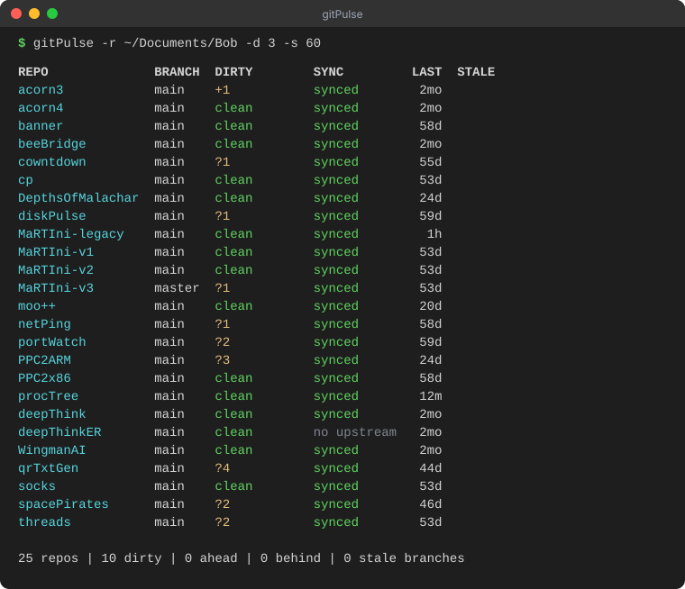

# gitPulse 💓

> *From the minds of IBM Bob & Daneyand...*

**Your pulse check for every git repo you own.** Point gitPulse at a folder (or three) and get a single, colorful screen that tells you which repos are dirty, which are ahead or behind, which have no upstream, and which have branches gathering dust.

No more `cd`-ing through twenty projects wondering "did I push that?" One command. One screen. Done.



---

## 📖 Table of Contents

- [Download](#-download)
- [Why gitPulse?](#-why-gitpulse)
- [Quickstart](#-quickstart)
- [Two ways to run it](#-two-ways-to-run-it)
- [Reading the output](#-reading-the-output)
- [Options](#-options)
- [Examples](#-examples)
- [Install the macOS binary](#-install-the-macos-binary)
- [Build it yourself](#-build-it-yourself)
- [How it works](#%EF%B8%8F-how-it-works)
- [FAQ](#-faq)
- [License](#-license)

---

## ⬇️ Download

Pre-built binary for **macOS Apple Silicon (arm64)**. No Python required:

```bash
curl -L https://github.com/007Style/gitPulse/releases/download/v1.0.0/gitPulse-1.0.0-macos-arm64.zip -o gitPulse.zip
unzip gitPulse.zip
cd gitPulse-1.0.0-macos-arm64
./install.sh
```

Then run it from anywhere:

```bash
gitPulse -r ~/code
```

Or grab the zip from the [Releases page](https://github.com/007Style/gitPulse/releases/latest). The zip contains the standalone `gitPulse` binary, the `gitpulse.py` source, an installer, the README and the license. See [Install the macOS binary](#-install-the-macos-binary) for details.

Prefer Python? Clone the repo and run the script directly. It has no dependencies:

```bash
git clone https://github.com/007Style/gitPulse.git
python3 gitPulse/gitpulse.py -r ~/code
```

---

## 🤔 Why gitPulse?

If you are anything like us, you have a folder full of repos: experiments, tools, old projects you swore you would finish. Somewhere in there is a forgotten commit that never got pushed, an untracked file that should have been committed, and a branch from three months ago that you are pretty sure was merged.

`git status` only tells you about **one** repo at a time. gitPulse tells you about **all of them**, in parallel, in about a second.

- 🔍 **Finds repos for you.** Give it a directory and it walks down looking for `.git`.
- ⚡ **Fast.** Repos are inspected in parallel, so 25 repos take about as long as a few.
- 🎨 **Easy on the eyes.** Green means good, yellow means "look at me", red means "you are behind".
- 🪶 **Tiny.** One Python file, standard library only. No `pip install` needed.
- 🍎 **Also a native binary.** A packaged macOS executable, so you can type `gitPulse` without `python3`.

---

## ⚡ Quickstart

```bash
# Scan the folder where your repos live
gitPulse -r ~/code

# Only show repos that need attention
gitPulse -r ~/code -a

# Scan several folders at once
gitPulse -r ~/code ~/work ~/experiments
```

Running from the Python source instead? Just swap in `python3 gitpulse.py` for `gitPulse`:

```bash
python3 gitpulse.py -r ~/code
```

---

## 🧰 Two ways to run it

| | Python script | macOS binary |
|---|---|---|
| **File** | `gitpulse.py` | `gitPulse` |
| **Needs Python?** | Yes (3.8 or newer) | No |
| **Needs `pip install`?** | No, standard library only | No |
| **Works on** | macOS, Linux, Windows (anywhere with git) | macOS (Apple Silicon build in releases) |
| **Run it** | `python3 gitpulse.py -r ~/code` | `gitPulse -r ~/code` |

Both do exactly the same thing. Pick whichever you like. The only hard requirement for either is that **`git` is installed and on your `PATH`**.

---

## 👀 Reading the output

```
REPO              BRANCH  DIRTY        SYNC         LAST  STALE
acorn3            main    +1           synced        2mo
cowntdown         main    ?1           synced       55d
deepThinkER       main    clean        no upstream   2mo
```

| Column | What it means |
|---|---|
| **REPO** 🟦 | The repo's folder name (cyan). |
| **BRANCH** | The branch you are on. `(detached)` means a detached HEAD. |
| **DIRTY** | Uncommitted work. 🟩 `clean` is a tidy working tree. 🟨 Otherwise you will see a mix of the counts below. |
| **SYNC** | How you compare with your upstream branch (see below). |
| **LAST** | How long ago the last commit was: minutes (`m`), hours (`h`), days (`d`), months (`mo`) or years (`y`). |
| **STALE** | Local branches (other than the one you are on) with no commits in the stale window. Shows up to three names, then `+N`. |

### The DIRTY symbols

| Symbol | Meaning |
|---|---|
| `+N` | **N** files staged and ready to commit |
| `~N` | **N** files modified but not staged |
| `?N` | **N** untracked files |

They combine, so `+1 ~2 ?3` means one staged file, two modified files and three untracked ones.

### The SYNC states

| Display | Color | Meaning |
|---|---|---|
| `synced` | 🟩 green | Local and upstream match. Nothing to do. |
| `↑N ↓0` | 🟨 yellow | You have **N** commits that are not pushed yet. |
| `↑N ↓M` (M > 0) | 🟥 red | Upstream has **M** commits you do not have. Time to pull. |
| `no upstream` | ⬜ dim | The branch exists but does not track a remote branch. |
| `no remote` | ⬜ dim | The repo has no remotes at all (local-only). |

### The summary line

```
25 repos | 10 dirty | 0 ahead | 0 behind | 0 stale branches
```

A one-line report card for the whole scan.

---

## 🎛 Options

| Flag | Long form | Default | What it does |
|---|---|---|---|
| `-r DIR [DIR ...]` | `--repos` | `.` (current directory) | One or more directories that contain your repos. Accepts `~`. |
| `-d DEPTH` | `--depth` | `2` | How many folder levels to search below each directory. |
| `-s DAYS` | `--stale-days` | `90` | Days without a commit before a branch counts as stale. |
| `-f` | `--fetch` | off | Run `git fetch` on every repo first, so ahead/behind is up to date. Slower, needs network. |
| `-a` | `--attention` | off | Hide repos that are clean and in sync. |
| | `--no-color` | off | Turn off ANSI colors. |
| `-h` | `--help` | | Show help. |

Colors turn themselves off automatically when the output is piped or redirected, so `gitPulse -r ~/code > report.txt` stays clean.

---

## 🍿 Examples

**The big picture** (this produced the screenshot above):
```bash
gitPulse -r ~/Documents/Bob -d 3 -s 60
```

**"What do I need to deal with before the weekend?"**
```bash
gitPulse -r ~/code -a
```

**"Am I really up to date with the remote?"** (fetches first)
```bash
gitPulse -r ~/code -f -a
```

**Repos live in several places:**
```bash
gitPulse -r ~/code ~/work/clients ~/Desktop/scratch
```

**Repos are buried deep:**
```bash
gitPulse -r ~/projects -d 4
```

**Aggressive branch hygiene** (stale after 30 days):
```bash
gitPulse -r ~/code -s 30
```

**Save a plain-text report:**
```bash
gitPulse -r ~/code > pulse-report.txt
```

**Use it as a Friday-afternoon ritual** by adding an alias to `~/.zshrc`:
```bash
alias pulse='gitPulse -r ~/code ~/work -a'
```

---

## 📦 Install the macOS binary

Grab the latest zip from [Releases](https://github.com/007Style/gitPulse/releases/latest) (or use the [download command](#-download) above), then:

```bash
unzip gitPulse-1.0.0-macos-arm64.zip
cd gitPulse-1.0.0-macos-arm64
./install.sh
```

`install.sh` copies `gitPulse` to `/usr/local/bin` (asking for `sudo` only if it needs to) and clears the macOS download-quarantine flag so Gatekeeper does not get in the way. To install somewhere else, pass a directory:

```bash
./install.sh ~/.local/bin
```

After that you can run `gitPulse` from any directory:

```bash
gitPulse -r ~/code
```

Prefer to do it by hand? Copy the `gitPulse` binary anywhere on your `PATH` and `chmod +x` it.

The zip contains:

```
gitPulse-1.0.0-macos-arm64/
├── gitPulse        ← the standalone binary
├── gitpulse.py     ← the Python source, if you prefer it
├── install.sh      ← installer
├── README.md
└── LICENSE
```

> 🍎 **First launch blocked by macOS?** Run `xattr -d com.apple.quarantine ./gitPulse`, or use `install.sh`, which does it for you.

---

## 🛠 Build it yourself

The packaging script uses [PyInstaller](https://pyinstaller.org) to turn the script into a single native executable.

```bash
pip3 install pyinstaller
./package.sh            # version defaults to the latest git tag, or 1.0.0
./package.sh 1.2.0      # or choose one
```

You will get:

```
dist/gitPulse-1.0.0-macos-arm64.zip
```

The binary is built for whatever architecture you run the script on (Apple Silicon gives `arm64`, Intel gives `x86_64`).

To regenerate the screenshot used in this README:

```bash
python3 docs/make_example_svg.py
```

---

## ⚙️ How it works

1. **Discover.** For each directory you pass with `-r`, gitPulse walks down (up to `--depth` levels) looking for folders that contain `.git`. When it finds a repo it stops there and does not dig into it. Hidden folders are skipped, and a repo listed under more than one `-r` directory is only shown once.
2. **Inspect, in parallel.** A pool of 8 worker threads runs a handful of quick, read-only git commands per repo:
   - `git rev-parse --abbrev-ref HEAD` for the branch
   - `git status --porcelain` for staged, modified and untracked counts
   - `git rev-list --left-right --count HEAD...@{u}` for ahead/behind
   - `git log -1 --format=%ct` for the last commit time
   - `git for-each-ref refs/heads` for stale branches
3. **Render.** Results are laid out in aligned columns, colored if you are in a terminal, and followed by the summary line.

gitPulse is **read-only**. The only time it touches anything is with `-f`, which runs `git fetch` (this updates remote-tracking refs, never your working tree or branches). It never commits, pushes, pulls, merges or deletes anything.

---

## ❓ FAQ

**Does it modify my repos?**
No. It only reads, apart from the optional `-f` fetch described above.

**Why does a repo say `no upstream`?**
Its current branch is not tracking a remote branch. Fix it with `git push -u origin <branch>`.

**Why does a repo say `no remote`?**
It has no remotes configured, so it exists only on your machine. Consider backing it up.

**Why does ahead/behind look out of date?**
gitPulse compares with what your machine last knew about the remote. Use `-f` to fetch first.

**It says "no git repositories found".**
Check the path, and try a larger `-d`. By default only two levels are searched.

**Does it follow symlinks or scan hidden folders?**
No to both, on purpose. It keeps scans fast and avoids loops.

**Does it work on Linux or Windows?**
The Python script should, anywhere Python 3.8+ and git are available. The packaged binary is macOS only for now.

**Are submodules or worktrees counted?**
They are detected if they have a `.git` file or folder, and show up like any other repo.

---

## 📄 License

MIT. See [LICENSE](LICENSE).

---

<p align="center"><em>From the minds of IBM Bob & Daneyand...</em></p>
